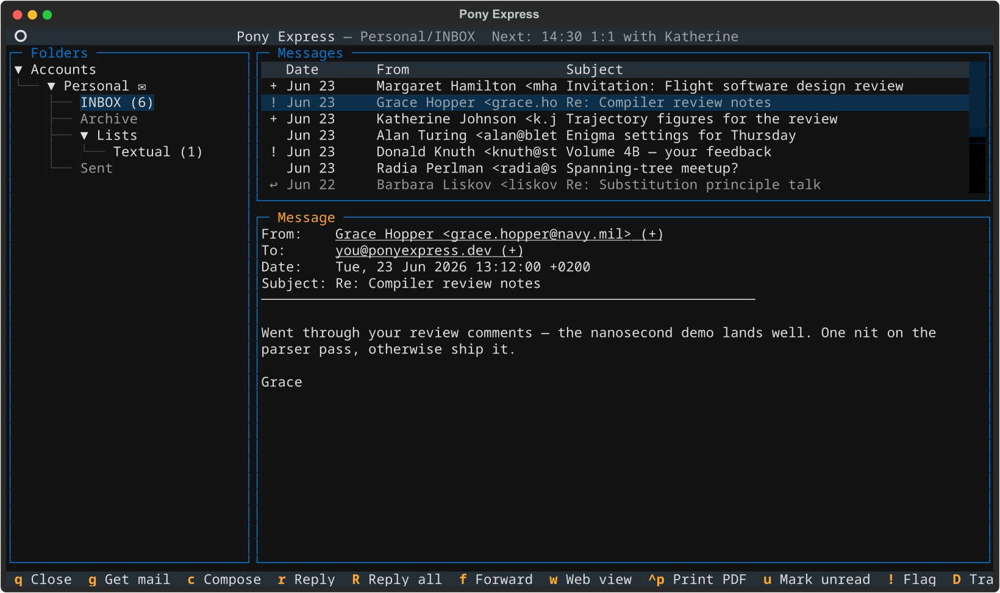
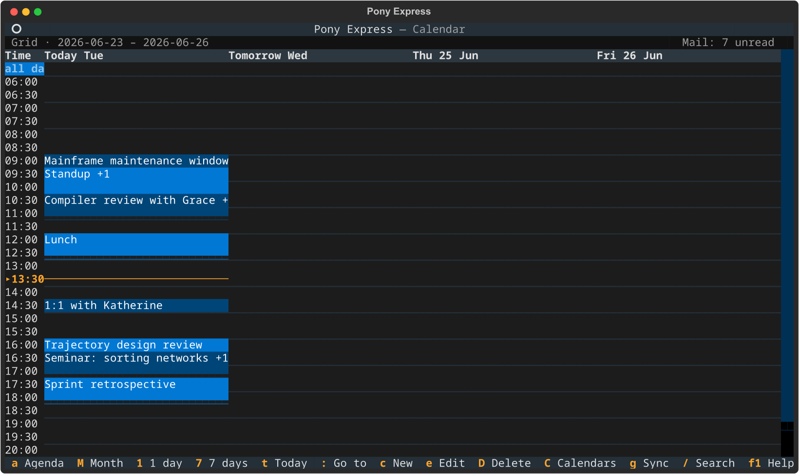

# Pony Express

Pony Express is a terminal-first **mail client and calendar**, written in
Python and driven from the keyboard. It is one program: one process, one
configuration file, one place where things are announced. ++f2++ puts the
agenda in front of the mail reader, and ++f2++ again brings the mail back
with the folder, cursor and scroll position exactly as they were.

**Mail** synchronises over IMAP, is stored locally in Maildir or mbox
format and indexed in SQLite for fast search. Outgoing mail goes over SMTP,
with optional Markdown rendering to `multipart/alternative`.

**The calendar** synchronises over CalDAV, mirrors every event as an
ordinary `.ics` file and indexes it with its own recurrence and alarm
caches. Agenda, single-day, multi-day and month views read from it, and
reminders are announced wherever you are looking.

Because they share a process, the two halves help each other: an invitation
in your mail files itself in the calendar and answers the organizer, an
event with attendees mails them the invitation with addresses completed
from your contacts, and each half shows one line about the other.



++f2++ switches to the agenda and back — see [Calendar](calendar.md):



!!! note
    All screenshots in this documentation are rendered from synthetic demo
    data — no real account, mailbox or calendar is involved, and the capture
    runs against its own throwaway store rather than any installed one.
    Regenerate them with `uv run python scripts/capture_screenshots.py`.

## Features

| Area | What it does |
|---|---|
| **Sync** | IMAP synchronisation with two-pass plan/execute, three-way flag merge, mass-deletion protection, progress reporting, and non-destructive conflict handling |
| **Storage** | Per-account local mirrors in Maildir or mbox format with batched SQLite transactions for fast indexing |
| **Index** | SQLite-backed metadata: full-text search across sender, recipients, subject, and body; flags, pending operations, and sync checkpoints in a unified message table |
| **TUI** | Three-pane terminal reader (Textual); browse, search, sync, flag mail without leaving the keyboard. Each screen shows only its own relevant keybindings |
| **Browser** | `pony web` serves the same mail, contacts and calendar over HTTP — the same keys, a button for every one of them, and a layout that reflows for a phone |
| **Composer** | Reply, forward, compose from scratch; Markdown mode produces `multipart/alternative` email; external editor support; attachment picker |
| **Contacts** | Person-centric address book with multiple emails per contact, aliases, interactive browser/editor with mark/merge/delete, BBDB import/export for Emacs interop |
| **Credentials** | Four backends: plaintext, environment variable, external command, OS-encrypted blob |
| **Diagnostics** | `pony doctor` checks config, index, mirror integrity, and dependencies; reports orphan files and stale index entries |
| **`.eml` files** | `pony file.eml` opens any message file in the viewer, with no account involved; `pony view --pdf *.eml` converts a directory of them to PDF from the command line |
| **Calendar** | CalDAV sync with CTag / `sync-collection` / full reconciliation paths, a local `.ics` mirror, recurrence and alarm caches, and agenda / day / multi-day / month views — reached with ++f2++ or `pony calendar ...` |
| **Events** | Create, edit and drag events on the time grid; all-day events, reminders announced wherever you are looking, per-calendar filtering, search, `.ics` import |
| **Invitations** | A `text/calendar` part is shown as an invitation and filed with one key, replying to the organizer; saving an event with attendees mails them the invitation, with addresses completed from your contacts |

## Requirements

- Python **3.13** or later
- [uv](https://docs.astral.sh/uv/) (recommended) or pip + virtualenv

## Installation

**From GitHub with uv (no clone needed):**

```bash
uv tool install git+https://github.com/juanjosegarciaripoll/pony.git
pony --help
```

**From source:**

```bash
git clone https://github.com/juanjosegarciaripoll/pony.git
cd pony
uv tool install .
pony --help
```

**Prebuilt relocatable archive** — download the `.zip` (Windows) or `.tar.gz`
(macOS/Linux) from the
[Releases](https://github.com/juanjosegarciaripoll/pony/releases) page,
extract it anywhere, and run the `pony` executable inside.

**Windows installer** — download `pony-windows-vX.Y.Z-setup.exe` from
[Releases](https://github.com/juanjosegarciaripoll/pony/releases) and run it.
The installer adds `pony` to your PATH automatically.

## Quick start

1. **Add your first account** (the wizard guides you through it):

    ```
    pony account add
    ```

    Or edit the config file directly:

    ```
    pony config edit
    ```

    !!! tip
        If you skip this step and run `pony tui` or `pony sync`, Pony
        detects the missing config and offers to launch the wizard automatically.

2. **Check the setup:**

    ```
    pony doctor
    ```

3. **Run your first sync:**

    ```
    pony sync
    ```

4. **Open the TUI:**

    ```
    pony tui
    ```

5. **Add a calendar** — optional, and separate from the mail accounts above.
   Put a `[calendar]` table with one `[[calendar.accounts]]` entry in the
   same config file, then press ++f2++ in the TUI. See
   [Calendar](calendar.md#adding-a-calendar-account).

See the [Configuration](configuration.md) page for a full reference on account
setup and credential backends.

## Application paths

A config file declares `data_dir`, and everything a run writes lives
inside it:

| Path | Contents |
|---|---|
| `<data_dir>/index.sqlite3` | The SQLite index |
| `<data_dir>/logs/` | Logs |
| `<data_dir>/calendar/` | The calendar's `.ics` mirror, index and OAuth tokens |
| `<data_dir>/profile.toml` | The profile stamp that says which config owns this directory |

Mirror directories are specified per-account and can live anywhere; a
relative `mirror.path` resolves under `data_dir`.

`data_dir` is required: Pony refuses to load a config that omits it, or
that gives a relative path. The platform-convention directory —
`~/.local/share/pony/` on Linux and macOS, `%LOCALAPPDATA%\pony\` on
Windows — is what a run uses when it has no config to read one from, which
is the case for `pony doctor`, `pony config edit` and `pony reset` on a
fresh install. `config.toml` itself is looked for in `~/.config/pony/` or
`%APPDATA%\pony\`.

The mirror is self-describing: a Maildir filename ends in
`,V=<uidvalidity>,U=<uid>`, the handle the message was fetched with. So
a lost index does not mean a lost mailbox — `pony reindex` rebuilds the
rows, and each folder's watermark, from the files already on disk,
without contacting a server. A file with no handle in its name is
indexed as local-only, which is what makes the next sync upload it.

A local account (`account_type = "local"`) has no server to re-fetch
from, so its mirror is the only copy of that mail: `pony reset` keeps
it and says so. `pony reset --account <name>` removes one on purpose.

### Running somewhere else

Two mechanisms, and no others:

- `--config <path>` names the config file to read, which decides the
  data directory through its `data_dir` key.
- `PONY_ROOT` relocates every directory Pony writes to underneath it,
  including a `data_dir` a config declares. It exists for sandboxed
  installs and for the test suite, which sets it so no test can reach a
  real directory.

## Documentation

| Page | Contents |
|---|---|
| [Configuration](configuration.md) | Full config reference, all fields, credential backends |
| [CLI Reference](cli.md) | Every command, flag, and example |
| [Terminal UI](tui.md) | Three-pane reader, keybindings, search, sync |
| [Browser Interface](web.md) | `pony web`: the same mail and calendar in a browser, on a phone |
| [Calendar](calendar.md) | CalDAV accounts, the views, events, reminders, invitations, keyboard reference |
| [Composer](composer.md) | Compose, reply, forward, Markdown mode, attachments |
| [Contacts](contacts.md) | Person-centric address book, browser/editor, BBDB import/export |
| [Mail Synchronization](synchronization.md) | Reference for the IMAP engine: conflict handling, safety features, caveats |
| [Architecture](architecture.md) | Technical design, subsystem boundaries, data flow |
| [Development](development.md) | Building, testing, contributing |
