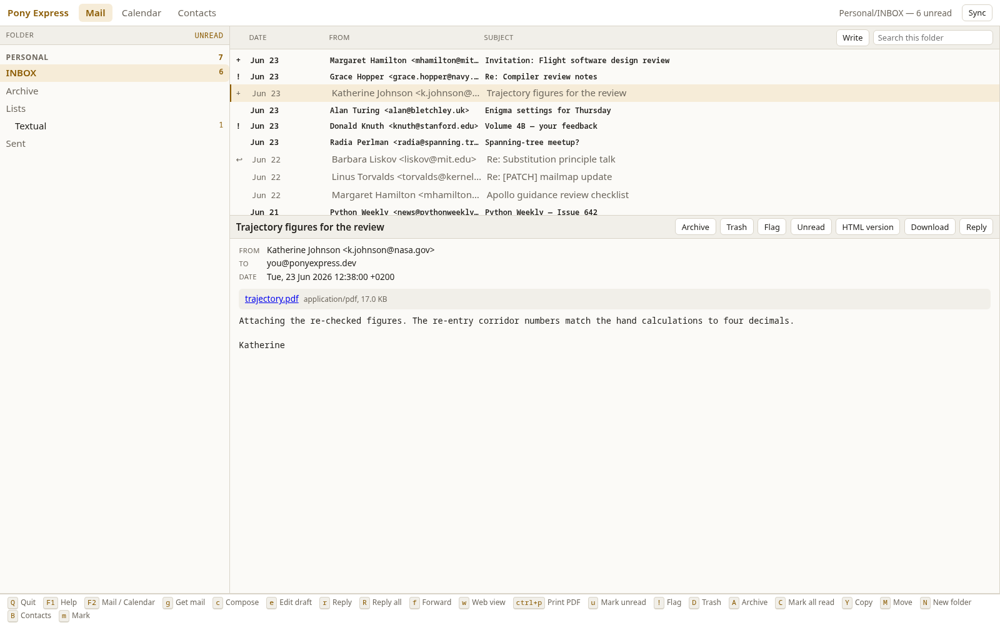
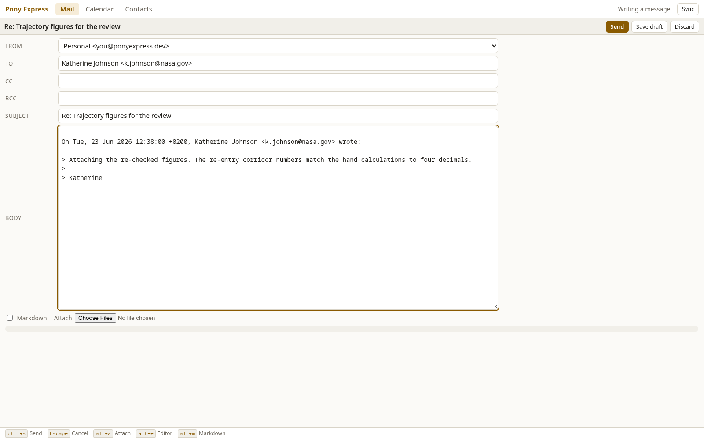
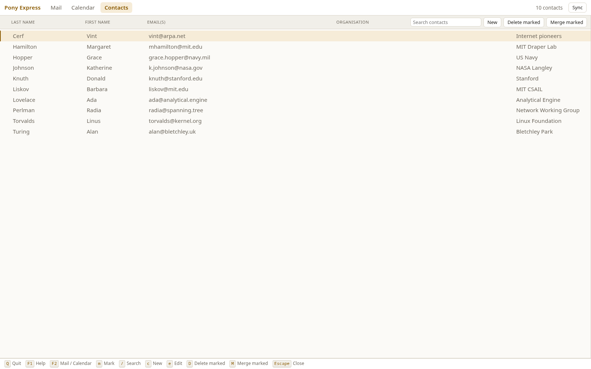
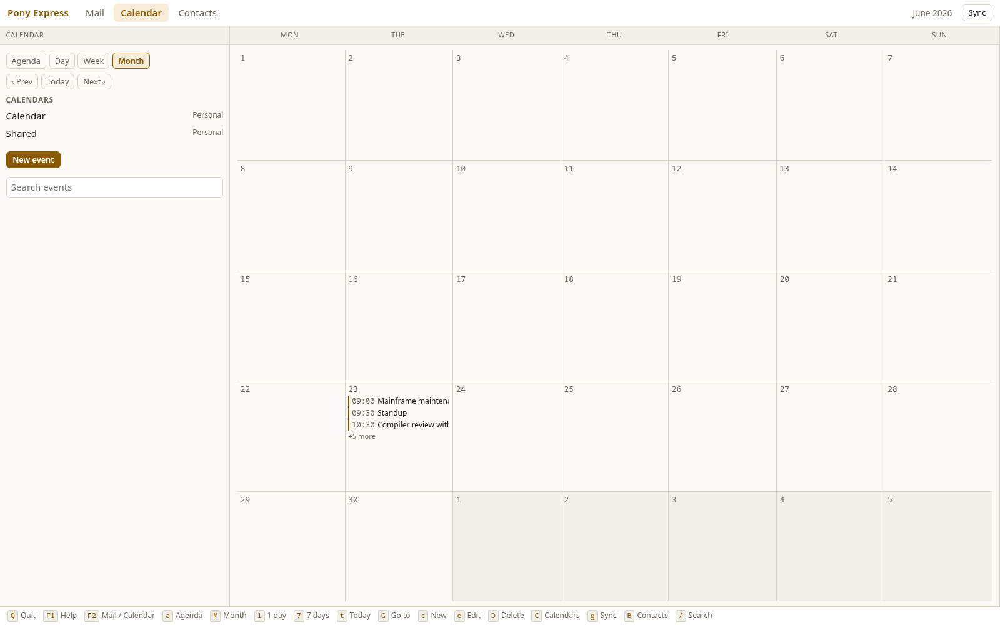
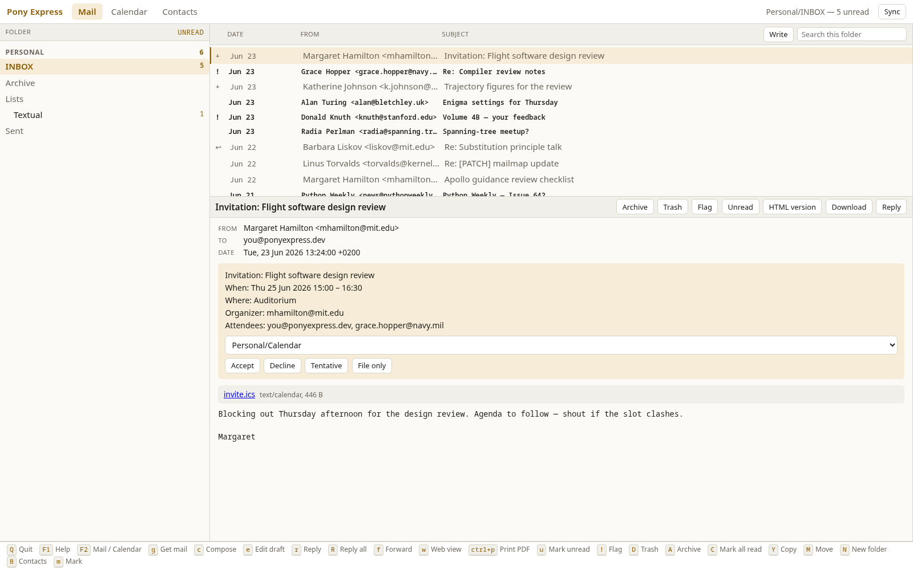
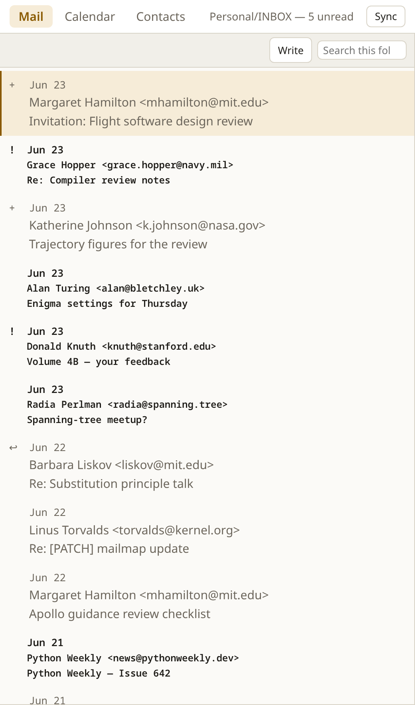

# Browser Interface

`pony web` serves the same mail and the same calendar over HTTP. It is a
second front end, not a second program: every operation it offers is the
one the terminal calls, every row it shows is the row the terminal
projects, and every key it answers to comes from the same table
++f1++ prints in the TUI. What is new is HTTP, HTML and a stylesheet.

It exists for the machine you are not sitting at: a phone on the same
tailnet, a laptop with a browser and no terminal, a tablet on the sofa.



The browser interface needs the `web` extra:

```bash
pip install 'pony[web]'          # or: uv sync --extra web
```

---

## Starting it

```
pony web [--host ADDRESS] [--port PORT] [--no-token]
```

```
$ pony web
Pony Express on http://127.0.0.1:8730/?token=k7Qf2xwbN0cR5tVhJm3PzLdA
The link carries the access token; it is remembered per browser.
```

The flags are listed under [CLI Reference → `pony
web`](cli.md#pony-web). Three things about that line matter:

- **The port is bound to loopback** unless you say otherwise, so until
  you pass `--host` the only way in is from the machine itself.
- **The token arrives in the URL once.** The first request that carries
  it gets back an `HttpOnly`, `SameSite=strict` cookie that lasts a
  year, so a phone needs the long link only the first time; afterwards
  `http://host:8730/` is enough on that browser.
- **Treat the link as the password**, because it is one. Anything that
  can route to the port and holds the token can read the mail.

Stop the server with ++ctrl+c++ where it was started, or with ++shift+q++
from the page — see [Quitting](#quitting).

!!! info "One instance, one user"
    There is deliberately no login form. Pony holds one user's
    credentials in one configuration file, so serving several people
    means an instance each, not a session each.

---

## The window

Every page is a full-screen application rather than a document: the
window is divided into panes, each pane scrolls on its own, and the page
itself never scrolls.

| Part | What is in it |
|---|---|
| **Title bar** | The three tabs — Mail, Calendar, Contacts — the status line, and the **Sync** button |
| **Status line** | What is open: the folder and its unread count, the month or date range, the number of contacts, or the active search |
| **Panes** | Folders beside the list, with the reader under the list when a message is open |
| **Footer** | The keys that are live on *this* page, built from the same table the page dispatches on |
| **Notices** | What an action reported, in the bottom corner, cleared after a few seconds |

Account, folder and message travel in the URL as query parameters, so
the back button means what it looks like it means and any view can be
bookmarked: a folder, a message, a search, a calendar month.

---

## Mail

The folder tree carries the unread counts and is grouped by account,
exactly as the [terminal's folder pane](tui.md#folder-pane) is. Choosing
a folder loads its list; choosing a row opens the message under the
list. **Opening a message marks it read**, as it does in the reader.

The reader shows the headers, the invitation if the message carries one,
the attachments, and the body as text. That is not a limitation of the
front end: the text is what `render_message` produces for the TUI, the
CLI and the MCP tools, and it carries neither tracking nor anything to
execute.

| Button | Key | What it does |
|---|---|---|
| **Archive** | ++shift+a++ | Move to the account's `archive_folder` |
| **Trash** | ++shift+d++ | Mark for deletion; the next sync expunges it |
| **Flag** | ++exclam++ | Toggle the starred flag |
| **Unread** | ++u++ | Mark unread again |
| **HTML version** | ++w++ | Open the message's own HTML in a tab of its own |
| **Download** | ++s++ | Save the message as it arrived, as an `.eml` |
| **Reply** | ++r++ | Open the composer, quoting and threading |
| **Write** | ++c++ | A new message from this folder's account |

**HTML version** opens a top-level page in a tab of its own — never a
frame inside the application, and this front end has no frames at all —
served with scripts, plugins and network access switched off, nowhere to
post a form and no way to re-base a relative URL. Inline images are
already embedded, so there is nothing left for such a page to fetch.
Attachments download with `nosniff`, which is what keeps a hostile byte
string from being interpreted as something executable.

!!! tip "Printing"
    There is no PDF export here, and none is needed: ++ctrl+p++ opens
    the HTML version in a tab and says so, and the browser's own print
    dialog turns that into paper or a PDF.

### Searching

The field in the list head runs the same search as ++slash++, in the
same [query language](tui.md#query-syntax) — `from:ada subject:review`
means the same thing in both front ends — scoped to the open folder.
Submitting it empty leaves the search, which is what ++escape++ does in
the terminal.

### Marking several rows

++m++ marks the row under the cursor and moves down; on a touch screen,
tapping a row's mark column does the same. Archive, trash, flag, move
and copy apply to every marked row, or to the selected row when nothing
is marked — the same rule the TUI follows.

### Folders

++shift+m++ and ++shift+y++ (move and copy) and ++shift+g++ (go to
folder) open a prompt that completes against every `account/folder`
pair the configuration knows about. ++shift+n++ creates a folder in the
local mirror; the next sync creates it on the server.

---

## Composing



New messages, replies, reply-all, forwards and resumed drafts all open
the same form, prepared by the same code the [Composer](composer.md)
screen uses — the quoting, the threading headers, the address lists and
the Markdown handling are not written twice.

| Control | Key | What it does |
|---|---|---|
| **Send** | ++ctrl+s++ | Send over SMTP and file the copy in Sent |
| **Save draft** | — | File it in Drafts and come back later with ++e++ |
| **Discard** | ++escape++ | Back to where the message was started from, after asking |
| **Attach** | ++alt+a++ | Pick files; each is uploaded as it is chosen |
| **Markdown** | ++alt+m++ | Render the body to `multipart/alternative` |

A send that fails leaves the form up with everything you typed still in
it, and says why. ++escape++ on a form you have typed into asks before
leaving it, and says to use Save draft; on a form you have only opened
it leaves without a word. The same on the event form.

Attachments are uploaded as raw bytes to a staging area under
`data_dir`; the form then carries a token rather than a path, so nothing
the page sends is ever opened as a file. A file over 25 MB is refused,
and the staged copies are removed once the message has gone out — and
when the server stops, whatever is left.

!!! warning "No external editor"
    ++alt+e++ — edit the body in `$EDITOR` — is the one key the browser
    cannot do. It is listed in the help and marked *terminal only*, and
    pressing it says so rather than appearing to work.

---

## Contacts



The same store the [Contacts](contacts.md) browser edits, with the same
four operations: **New**, **Edit** (++e++, or open a row), **Delete
marked** and **Merge marked**. Marking works as it does in the message
list — ++m++, or a tap on the mark column — and a merge folds every
marked record into the first of them, summing the message counts, as
[Merging contacts](contacts.md#merging-contacts) describes.

**Delete marked** and **Merge marked** act on the marks and on nothing
else: with nothing marked they say so rather than taking the row the
cursor happens to be on. Both ask before acting, because neither can be
undone, and the merge names the record that will survive. So does
deleting an event.

The search field matches names, aliases and addresses. BBDB import and
export stay on the command line (`pony contacts import|export`), as does
the harvest of an existing archive — though ++shift+h++ harvests the
folder on screen from here too.

---

## The calendar



The Calendar tab offers the four views the terminal offers — agenda,
day, week and month — from the same projections, so a span, a column and
an hour axis are computed once for both. The left-hand pane holds the
view switcher, **‹ Prev / Today / Next ›**, the per-calendar filters,
**New event** and a search field.

| Key | View |
|---|---|
| ++a++ | Agenda |
| ++1++ … ++7++ | One day, or that many days across |
| ++shift+m++ | Month |
| ++t++ | Today |
| ++shift+g++ | Go to a date |
| ++n++ / ++p++ | A day forward or back |
| ++c++ / ++e++ / ++shift+d++ | New event, edit the selected one, delete it |

Which view, which date and which calendars are showing all live in the
URL, so a week can be bookmarked and the back button steps through what
you looked at. The event form saves with ++ctrl+s++, deletes with
++ctrl+d++ and leaves with ++escape++.

[Calendar](calendar.md) is the manual for everything the events
themselves do: accounts, recurrence, reminders, `.ics` import and the
scope of each view.

### Invitations



A message carrying a `text/calendar` part shows what it proposes above
its body, with the calendar to file it in and the answer to send:
**Accept**, **Decline**, **Tentative**, or **File only** to put it in
the calendar without telling the organizer. The event is filed first and
the reply sent after, so a reply that cannot be sent is reported without
costing you the event — see [Terminal UI →
Invitations](tui.md#invitations) for what each answer means.

---

## The keyboard

The browser does not have a keymap of its own. It fetches
`/keymap.json`, which serves `pony.keymap` and `chronos.keymap` — the
tables the Textual screens build their bindings from — one list per page,
and matches `keydown` against it. A key cannot mean one thing in the
terminal and another here, and the footer cannot advertise a key the
page does not answer to.

++f1++ opens the full list for the page you are on. **A key the terminal
has and the browser cannot do is listed and marked** rather than quietly
ignored.

So the reference is the terminal's: [mail keys](tui.md#navigation),
[compose keys](composer.md), [calendar keys](calendar.md). What is worth
knowing is where the browser differs:

| Key | In the browser |
|---|---|
| ++g++ / ++ctrl+g++ | Both fetch mail; a request is already out of the way of the page, so there is nothing for a second, quieter sync key to mean. On the Calendar tab, ++g++ syncs the calendar |
| ++w++ / ++ctrl+p++ | Open the message's HTML in a new tab — the second one for printing |
| ++s++ | Download the `.eml`; ++shift+o++ and ++shift+s++ download the first attachment |
| ++slash++ ++shift+g++ ++shift+m++ ++shift+y++ ++shift+n++ | Search, go to a folder, move, copy, new folder: a one-line prompt, completing against every folder, where the terminal opens a dialog |
| ++ctrl+left++ ++ctrl+right++ ++ctrl+up++ ++ctrl+down++ | Resize the panes; the sizes are remembered per browser, because it is that window they describe |
| ++enter++ | Open whatever the cursor is on |
| ++alt+e++ | Not available: editing the body in `$EDITOR` needs a terminal |

While the cursor is in a text field, plain keys are left to the field —
typing `D` in a subject line writes a `D`. Chords still reach the
application: ++ctrl+s++ sends, ++escape++ cancels.

---

## Buttons, and a phone



Every key that changes something has a button or a link as well, because
a phone has no keyboard: Archive, Trash, Flag, Unread, Write and Reply
around the message; Delete marked and Merge marked on the contacts page;
New event and the view switcher in the calendar's pane; Sync in the
title bar; a search field in each list head. They are the same actions
the keys invoke, not a parallel set.

On a narrow screen the layout shows one pane at a time:

- The folder tree — or the calendar's view pane — becomes a page of its
  own. **Tap the status line** to show it and tap again to put it away.
- Opening a message replaces the list rather than squeezing it.
- A row puts its date, correspondent and subject on three lines, with
  the mark column down the side to tap.
- The footer of keys is hidden, and the buttons are sized for a thumb.

---

## Syncing

++g++, or the **Sync** button, runs the engine `pony sync` runs and
reports the sentence it reports. The page says `Syncing…` while it
works, then shows what changed and refreshes the list and the unread
counts in place, leaving the open message and the scroll positions where
they were.

The server holds **one sync slot of its own**, so two tabs — or a tab
and the periodic thread — cannot start two syncs on one account; the
second is told the first is still running. Across processes it is your
call: a terminal left open somewhere is not a reason for the phone to
refuse.

With `background_sync_enabled = true` in the configuration, `pony web`
runs the periodic sync as well, so a phone sees new mail without anyone
pressing anything — the same thread, the same interval and the same
slot as in the terminal, described under [Mail Synchronization →
Background sync](synchronization.md#background-sync).

### When a sync would delete a lot

The engine halts a folder whose plan would delete a large share of it,
or push a large number of messages, rather than carrying on. The browser
asks the same question the terminal asks, in the same words:

```
Personal/INBOX would delete 412 of 500 (82%). A large share of a folder
would be deleted locally, or uploaded to the server. A server-side purge
of old mail looks like this, and so does a misconfigured account or an
index that lost its UIDs.

Apply the sync anyway?
```

**Nothing is applied until you agree.** Answering yes re-runs the sync
with that folder confirmed; answering no leaves everything as it was,
and the other folders are unaffected either way. The guard itself is
described under [Mail Synchronization → Mass-deletion
protection](synchronization.md#mass-deletion-protection).

The Calendar tab syncs the calendar instead, which takes a lock of its
own so a `pony calendar sync` elsewhere cannot collide with it.

---

## Quitting

++shift+q++ means the same thing here as in the reader: stop Pony. Both
halves happen — the server is asked to stop itself, because a page
cannot end a process, and the tab then closes.

A tab you opened yourself cannot be closed by a script, so if the
browser refuses, the page says that Pony Express has stopped and that
you can close the tab, rather than leaving a window that no longer
works.

---

## What stands between the port and the mail

| | |
|---|---|
| **Binding** | `127.0.0.1` unless `--host` says otherwise |
| **Token** | A fresh random token per run, in the URL once, then an `HttpOnly` `SameSite=strict` cookie for a year; compared in constant time |
| **`--no-token`** | Serves without it, for an address that is already restricted to people who may read the mail |
| **Where a request came from** | Anything that changes something is refused unless the browser says it came from Pony's own page, token or no token: `Sec-Fetch-Site` when it is sent, the `Origin` otherwise. A client that sends neither — curl, a script, a phone shortcut — is let through |
| **Message HTML** | A top-level page of its own, opened in a separate tab (never a frame — there are none in this front end), with `default-src 'none'`, images limited to the data URIs already inlined, `form-action 'none'` and `base-uri 'none'` because neither falls back to `default-src`, `frame-ancestors 'none'`, and no referrer |
| **Attachments** | Downloaded with `X-Content-Type-Options: nosniff` |
| **The page itself** | One stylesheet and one script, no framework and no CDN: a tailnet has no reason to reach the public internet, and a front end that needs one stops working on a train |

A tailnet is the case `--no-token` is for. Either bind the tailnet
address:

```bash
pony web --host 100.101.102.103 --no-token
```

or leave the server on loopback and publish it:

```bash
tailscale serve --bg 8730
```

Either way the device at the other end has already authenticated to the
tailnet, and the token is a second lock on the same door. Anywhere else
— a LAN, a VPS, a port forwarded through a router — keep it.

Dropping the token does not open the mailbox to every page the browser
has open: a page served from anywhere else cannot archive, send or
delete, because the server reads what the browser says about where the
request came from and refuses anything that is not Pony's own page.
What `--no-token` gives up is *reading* — anything that can route to
the port can fetch a page.

!!! danger "Do not put it on the open internet"
    There is no login, no rate limiting and no second factor. The token
    is the whole of the access control, and a URL ends up in history,
    in logs and in whatever the browser syncs. Reach it through a
    tailnet, a VPN or an SSH tunnel.

---

## What is only in the terminal

- Editing a message body in `$EDITOR` (++alt+e++).
- Opening an attachment in a helper application — here they download.
- The account wizard, BBDB import and export, `doctor`, `reindex` and
  the rest of the [command line](cli.md).
- The MCP server, which `pony tui` hosts for a local model
  ([MCP Server](mcp-server.md)).
